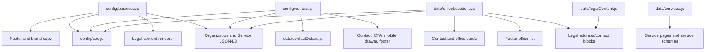

# Business Information Centralization Plan

**Status:** Planning only — no source changes made  
**Repository:** `/Users/ritweek/Desktop/Clearfiling/ClearFiling`  
**Inputs:** `docs/business_information_verification_checklist.md` and the project information supplied for Step 8.

## Objective and guardrails

Centralize business identity, contact methods and office records while preserving the current React/Vite architecture, blue-and-white design, approved service content, service URLs, canonical URLs, indexability and sitemap. A later implementation must not silently substitute project information for unverified operational details.

Project-approved baseline for this plan:

- Brand: **ClearFiling**
- Legal name as supplied in the project brief: **Clear Filing & Compliance LLP**
- Physical office cities: **Delhi, Deoria and Gorakhpur**
- Online service coverage: **Across India**
- Tagline wording: **Integrity, sanctity, dedication**
- Public document categories: **Public Documents** and **Draft Documents**

The project approval above does not verify street addresses, postcodes, landmarks, coordinates, phone/email ownership, hours, response commitments, founding/incorporation dates, staff credentials, metrics, testimonials or service-by-service jurisdiction/eligibility claims. Existing values must remain intact until an explicit owner decision authorizes correction/removal.

## Current duplication map

| Business fact | Current sources / copies | Main consumers and risk |
|---|---|---|
| Brand and legal name | `client/src/config/business.js`; duplicated in `client/index.html`, legal text in `client/src/data/legalContent.js`, about-page copy in `client/src/pages/About.jsx`, SEO strings in `client/src/config/seo.js`; `client/src/data/companyInfo.js` aliases the config | Footer, metadata, legal pages and JSON-LD can disagree if any copy changes alone. Current legal name differs from the project-approved wording. |
| Tagline | `business.js`; repeated as text in About and AboutSection | Punctuation and style differ; content is not consistently generated from the config. |
| Website identity/URL | `business.js`, `config/seo.js`, `client/index.html`, JSON-LD, breadcrumbs, service `canonicalSlug` records and `client/scripts/generateSitemap.mjs` | Do not change in this plan. These URLs are SEO-critical; centralizing URL construction must be a separate, tested change that preserves output exactly. |
| Phone, WhatsApp, email | `client/src/config/contact.js`; duplicate literals/objects in `client/src/data/companyInfo.js`, `client/src/data/footerConfig.js`, office records, `Contact.jsx`, `About.jsx`, `BlogPost.jsx`, `ServiceDetail.jsx`, `FeaturedServices.jsx`, `CTASection.jsx`, `ResourcePageLayout.jsx`, `ContactHero.jsx` and `SchemaHelpers.js` fallback strings | Different CTAs can point to stale or different destinations; schema can publish fallback values instead of config values. |
| Office names, cities and addresses | `client/src/data/officeLocations.js`; separately duplicated in `companyInfo.js`, `footerConfig.js` and `legalContent.js`; rendered in OfficeLocations, Contact, Footer, MobileDrawer and schema | A change may update some visible cards but leave footer/legal/schema copies behind. Address facts remain unverified; city names are project-approved. |
| Office phone/email association | `officeLocations.js`; repeated in `companyInfo.js`; `footerConfig.js` has separate office-specific phone value | The source does not consistently define whether each phone/email is a personal, central or office line. Confirm associations before replacing copies. |
| Hours and response service levels | `contact.js`; copies in `companyInfo.js`, `footerConfig.js`, `faqContact.js`, `Contact.jsx`, `ContactHero.jsx` and `config/seo.js` | “Office hours,” online response hours and LocalBusiness opening hours are currently treated similarly; displayed SLAs vary by surface. |
| Metrics and counts | `business.js.stats`, `companyInfo.js`, `Hero.jsx`, `StatsStrip.jsx`, `AboutSection.jsx`, `About.jsx`, `TestimonialsSection.jsx`, `ContactHero.jsx`, `WhyChooseSection.jsx`, `Services.jsx` and SEO text | Many hardcoded copies; current figures include client/filing counts, satisfaction, professional count, years, office count, service count and average rating. Values have not been owner-verified. |
| Qualifications/expertise | About team/timeline, Hero “Verified CA, CS & Legal Advisory Services,” AboutSection illustration text, WhyChoose, SEO metadata, `companyInfo.experts`, legal professional-conduct statement and service catalogue | Qualifications, membership, staff relationships and supervision claims are repeated and not validated by the project brief. |
| Services/nationwide availability | `client/src/data/services.js`, `resourcesContent.js`, `blogContent.js`, `faqContact.js`, `Contact.jsx`, `config/business.js`, SEO descriptions and About/feature copy | The service catalogue is the current detailed offering source, but broad “all services/no visit” and nationwide claims are repeated. Preserve approved service copy; later owner review should clarify exclusions and whether the firm performs or facilitates each action. |
| Social accounts | `footerConfig.js`, `config/seo.js` (`sameAs` and Twitter handle), `companyInfo.js` | Account ownership and official URLs need confirmation; the social values are not part of the three primary facts configs today. |
| Testimonials and named clients | `TestimonialsSection.jsx`, `client/src/data/topClients.js` | Names, quotations, roles, ratings, client list and permission evidence are not centralized with verified status. Do not alter or republish them differently until approved. |
| Legal identity/contact statements | `client/src/data/legalContent.js` contains static legal entity names, emails, phones and full office addresses | Legal prose is a content module and should stay the content authority; factual tokens can be rendered from canonical data after legal review rather than repeated literal values. |
| Public document categories | Admin UI labels/routes and backend document status/category models (separate from business facts) | Approved policy is Public Documents plus Draft Documents (sample letters/formats); drafts are intended for public delivery when published. Keep the existing behavior and do not change storage architecture. |

## Proposed source-of-truth architecture

### 1. `client/src/config/business.js` — organization-level identity

Use this for the organization/brand facts only:

- Canonical public brand name and approved alternate brand name, if retained.
- Approved legal name, tagline, concise company description.
- Approved founding/incorporation values only if owner confirms what each date represents.
- Site URL/organization IDs and broad area served, if retained here for compatibility.
- Owner-approved social profile URLs and organization-level marketing claims, if approved.

Separate confirmed values from unverified values in the implementation. Do not treat the current `BUSINESS.stats` object as verified merely because it is in a central file. After owner review, either add only approved public claims to a clearly named section with definition/source/as-of metadata, or keep those claims out of shared config. Do not invent replacement values.

### 2. `client/src/config/contact.js` — global contact channels and service hours

Use as the only source for central phone, WhatsApp, email, generic inquiry hours and response commitments. Derive tel/mail/WhatsApp links from the confirmed number/email rather than duplicating string literals. Distinguish:

- Main/public phone from office-specific telephone lines.
- WhatsApp number from display label and message text.
- Contact-center/inquiry response hours from physical office opening hours.
- Response targets from guaranteed service commitments.

Do not migrate/update current values until their owner confirms them.

### 3. `client/src/data/officeLocations.js` — physical office registry

Keep one record per physical location, keyed by stable IDs (`delhi`, `deoria`, `gorakhpur`). It should own city, approved label/status, approved full address and schema address fields, per-office phone/email if appropriate, opening-hours data only when verified, coordinates and map links only when confirmed. Consumers should map records into display-specific presentation rather than copy values into another data file.

The approved cities do not approve the exact current street addresses, “Head Office” status, branch status, postcode, landmark, phone association or coordinates. Do not alter these records during planning.

### 4. Existing service catalogue and legal content

- `client/src/data/services.js` remains the detailed source for service records and approved descriptions. Keep service IDs/slugs, canonical URLs, indexing flags, redirects and existing approved/legal content unchanged. Centralize only true company-wide factual claims repeated outside the catalogue; service-specific delivery, qualification and jurisdiction assertions remain per-service content and require their own owner/legal review.
- `client/src/data/legalContent.js` remains the source for policy and legal wording. After review, replace repeated identity/contact/address literals with explicit data bindings or narrowly scoped tokens consumed by the legal-page renderer. Keep clauses, refund/processing terms, privacy commitments and disclaimers as authored content; do not create broad blind string substitution or change legal wording without review.
- `client/src/data/resourcesContent.js` and `blogContent.js` remain the source for their authored content. Their authored business claims should be inventoried/reviewed rather than silently rewritten through global substitutions.

### 5. Compatibility layers and presentation

- `client/src/data/companyInfo.js` currently mixes identity, metrics, contacts, offices, social links and schema fields. Migrate its consumers to the three approved sources and, if necessary, temporarily keep `COMPANY_INFO` as a derived compatibility adapter. It must contain no independent literals. Remove the adapter only after all imports are migrated and tests confirm no consumers remain.
- `client/src/data/footerConfig.js` should retain footer-only navigation/link structure, but derive company/contact/office values from `business.js`, `contact.js` and `officeLocations.js`. `FOOTER_OFFICES` should be a projection of the office array, not another address registry.
- `client/src/data/contactDetails.js` already derives contact cards from `contact.js`; retain that direction and test the rendered links.
- Visual components should render values from configs while preserving current layout, wording/approved copy, CSS classes, brand colors and responsive behavior.

### 6. SEO, metadata and structured data

- `client/src/config/seo.js` should compose brand/legal/contact/office facts from the authoritative configs. Keep page-specific content descriptions where they are genuinely editorial, but do not repeat unverified numerical or credential claims in page titles/descriptions.
- `client/src/components/seo/SchemaHelpers.js` and JSON-LD factories should receive or import the canonical business/contact/office sources. Remove hardcoded fallback phone/email literals only after a safe, explicit data contract exists; an absent value must not be silently replaced by invented data.
- Keep current `SEOHead` interface, canonical values, indexability policy, URLs and sitemap URLs unchanged.
- `client/index.html` must keep a correct homepage fallback for JavaScript-disabled and social consumers. Since HTML cannot import the JS config, either (a) add a deterministic build-time metadata generator from the approved configs or (b) establish an explicit generated/checked contract. Prefer generation with a check that proves output parity; do not casually delete fallback tags or alter route metadata semantics.
- Sitemap generation should not be changed as part of fact migration unless a separate approved change is necessary. The current service slug and 44-URL sitemap behavior must remain byte/URL-equivalent where practical.

## Dependency map: current consumers and proposed data flow

Target dependency direction: **UI → derived presentation adapter → approved config/data modules**. Config/data modules must not import components. `companyInfo.js` and `footerConfig.js` are compatibility projections during migration, not additional authorities.

## Exact files likely to require modification in an approved implementation

The list is based on current imports and literal searches. It is a planning inventory, not authorization to modify these files.

### Primary data and metadata

- `client/src/config/business.js`
- `client/src/config/contact.js`
- `client/src/data/officeLocations.js`
- `client/src/data/companyInfo.js` (derive/deprecate compatibility view)
- `client/src/data/footerConfig.js` (derive view; keep navigation presentation data)
- `client/src/data/contactDetails.js` (likely no structural change; add/use tests)
- `client/src/config/seo.js`
- `client/src/components/seo/SchemaHelpers.js`
- `client/src/components/seo/JsonLd.jsx` (only if schema generation wiring needs adjustment)
- `client/index.html`
- Potential new `client/scripts/generateBusinessMetadata.mjs` plus `client/package.json` build-script integration, only if selected for static fallback generation. Must not regenerate or change sitemap/indexing.

### Pages and presentation consumers with duplicate facts

- `client/src/pages/About.jsx`
- `client/src/pages/Contact.jsx`
- `client/src/pages/Services.jsx` (service-count label)
- `client/src/pages/ServiceDetail.jsx` (phone/WhatsApp CTAs)
- `client/src/pages/BlogPost.jsx` (phone/WhatsApp CTAs)
- `client/src/layouts/ResourcePageLayout.jsx` (phone/WhatsApp CTAs)
- `client/src/layouts/LegalPageLayout.jsx` (legal entity title already reads `BUSINESS`; change only if renderer needs dynamic legal fact tokens)
- `client/src/components/common/Footer.jsx`
- `client/src/components/common/FloatingCTAs.jsx`
- `client/src/components/common/CTAButtons.jsx`
- `client/src/components/common/MobileDrawer.jsx`
- `client/src/components/contact/ContactHero.jsx`
- `client/src/components/contact/ContactInfoCards.jsx`
- `client/src/components/contact/OfficeLocations.jsx`
- `client/src/components/features/Hero.jsx`
- `client/src/components/features/AboutSection.jsx`
- `client/src/components/features/StatsStrip.jsx`
- `client/src/components/features/WhyChooseSection.jsx`
- `client/src/components/features/TestimonialsSection.jsx` (only approved metrics/rating source; testimonials remain separately gated)
- `client/src/components/features/FeaturedServices.jsx`
- `client/src/components/features/CTASection.jsx`
- `client/src/components/features/TopClientsSection.jsx` (claims only; client identities remain owner-approved data)

### Content modules and tests

- `client/src/data/legalContent.js` (factual tokens/addresses only after legal review)
- `client/src/data/faqContact.js` (hours, response promises, coverage/contact facts)
- `client/src/data/topClients.js` (no content change unless approvals direct it; tests/approval status may be added later)
- `client/src/data/services.js` (only a later scoped review of repeated firm-wide facts; preserve service content, IDs/slugs and SEO fields)
- `client/tests/brandSeo.test.js`
- `client/tests/wave1Content.test.js`
- `client/tests/serviceRegistry.test.js`
- `client/tests/documentationSection.test.js` only if testing unrelated shared layout output becomes necessary
- New focused test file, e.g. `client/tests/businessInformation.test.js`, for cross-surface source parity.

## Migration order

1. **Owner confirmation gate:** Resolve the legal-name spelling, approve or correct addresses and contact channels, specify founding versus incorporation date, and decide each metric/credential/testimonial/promise. Mark each as keep, correct, or remove. Do not implement uncertain edits.
2. **Capture baseline:** Record current service slugs, canonical URL outputs, indexable/noindex decisions, redirects, sitemap URL list, key rendered page copy and JSON-LD. Preserve the existing working tree; isolate the new work so unrelated modifications remain untouched.
3. **Add parity tests first:** Assert current/owner-approved identity, contact links, three office cards, legal-page facts, metadata and schema output. Add tests for aliases/derived adapters and for no hardcoded fallback values.
4. **Define config contracts:** Clarify `business.js` identity fields, `contact.js` channel/hours distinction and `officeLocations.js` location fields. Do not move unverified values into a section that implies approval.
5. **Derive adapters:** Convert `companyInfo.js` and `footerConfig.js` into views/projections while retaining exports. Keep navigation/footer labels and visual structure where not factual.
6. **Migrate low-risk components:** Contact detail cards, office cards, footer, floating CTAs, mobile drawer and common CTA components; test tel/mail/WhatsApp links and visual DOM structure.
7. **Migrate page copy/data:** Contact, About, Services, service/blog/resource CTA surfaces and FAQ. Preserve approved service wording and route/slug behavior. Reconcile only owner-directed claims.
8. **Migrate legal content with legal review:** Parameterize only entity/contact/address facts, preserving legal prose and terms. Render representative legal pages and compare copy before/after.
9. **Migrate SEO/schema/static fallback:** Compose SEO text and JSON-LD from approved values; add deterministic static metadata generation/check if approved. Do not alter `SEOHead` indexing behavior, canonicals, service URLs or sitemap membership.
10. **Full verification and review:** Run focused/client tests, build, inspect HTML fallback, rendered pages, JSON-LD, exact contact `href`s and git diff. Confirm no content/visual/service-URL/indexing/sitemap drift. Update documentation after results.

Small batches should be independently testable. If the owner has not approved a claim, do not centralize it as an authoritative fact or quietly remove it; leave it unchanged and record the pending decision.

## Regression tests required

- **Identity parity:** brand and legal name values in page footer, legal headings/body, homepage fallback, SEO metadata and Organization/LocalBusiness JSON-LD all use the same approved source.
- **Contact parity:** visible phone/email values match `tel:`, `mailto:` and WhatsApp links; office-specific numbers remain attached to the intended office; Contact, Footer, About, Blog, ServiceDetail, resource CTA and MobileDrawer surfaces agree.
- **Office parity:** cards, footer, contact page, legal contact blocks and JSON-LD derive the same three office IDs/cities and only owner-approved detailed address values. Ensure no fourth physical location is introduced.
- **Claims parity:** owner-approved counts/credentials/SLAs appear consistently; unapproved claims are not newly asserted as verified; testimonials/rating and the displayed average follow the approved data/source.
- **Service preservation:** registry test remains unchanged for all service records, IDs/slugs, redirect map, 23 current indexable service slugs and 66 noindex pages. Preserve existing service copy and links except specifically approved business-fact tokens.
- **SEO and sitemap preservation:** canonical URLs and noindex behavior match baseline; the sitemap remains exactly the existing URL set (currently tested at 44 URLs); no redirect or indexing change is introduced.
- **Static fallback:** generated/checked `client/index.html` business metadata matches approved config and does not remove homepage fallback tags. Avoid invoking a sitemap-writing script in a way that creates unreviewed sitemap changes.
- **Legal rendering:** privacy, terms and disclaimer render the approved entity/contact facts without changing legal clause text unexpectedly; compare rendered text snapshots or focused assertions.
- **Visual/accessibility smoke tests:** preserve existing blue-and-white CSS, office/footer/contact DOM structure, responsive layouts, accessible link labels and CTA functionality.
- **Commands after implementation:** at minimum `npm test --prefix client`, `npm run build --prefix client` (review its sitemap diff explicitly), and the client lint script if the touched files are lint-compatible. Run admin/server suites only if implementation crosses those app boundaries; this plan does not require those changes.

## Owner decisions still needed

The following details remain open even though the Step 8 baseline facts are approved:

1. Exact officially registered legal entity spelling and whether project-approved wording should be identical in legal disclosures.
2. Whether “Clear Filing” remains an approved alternate brand name; approved tagline punctuation/case.
3. Founding/practice start date versus LLP incorporation date and timeline milestone approval.
4. Exact premises, postcodes, landmarks, map coordinates, headquarters/branch designations and per-office phone/email association for Delhi, Deoria and Gorakhpur.
5. Current mobile, landline, WhatsApp, email inboxes, ownership/monitoring, hours, time zone, call coverage and response SLA.
6. Whether online coverage applies to every catalogue service and what state/client/document/in-person exceptions exist.
7. Current employee/partner/contractor/referral roster; CA/CS/legal/merchant-banking/cost-accounting qualifications and approved wording.
8. Evidence and as-of dates for clients served, filings completed, satisfaction, average rating, professional headcount, services count and experience.
9. Authenticity, rating methodology and publication permissions for each testimonial and named client/company.
10. Approval of service and marketing claims, including “no delays,” faster-than-industry, free consultation, guarantees, processing/approval timelines, direct-versus-facilitated work and regulatory supervision.
11. Official social account URLs/handles and whether they belong in structured data.
12. Legal reviewer approval for privacy, refund, liability, confidentiality and professional-code statements.

## Risks and rollback approach

### Risks

- Changing the legal name before confirmation can change public/legal identity in footers, contracts/notices and rich-result JSON-LD. The source change must remain gated even though the project brief supplies its wording.
- Centralizing current but unverified values can make them more consistently wrong. Approval status and evidence need to precede shared reuse.
- `COMPANY_INFO` and `FOOTER_*` exports may have hidden consumers; retain compatibility exports until repository search and tests prove they are unused.
- Replacing legal content through broad string substitution can alter legal meaning or punctuation. Use narrow, explicit data binding and review rendered legal pages.
- Reusing generic contact channels for each office can mislabel office phone numbers or contact destinations. Preserve per-office fields unless their meaning is approved.
- Static HTML and sitemap are build outputs with different generation paths. Do not let business metadata centralization change sitemap URL membership, canonical output or indexing directives.
- Generic claims embedded in authored services/resources/blogs require editorial review, not blind config interpolation.
- This repo currently contains pre-existing tracked and untracked work. Avoid whole-tree formatting, cleanup, reset or rollback operations.

### Rollback

- Implement in a dedicated branch/worktree or clearly isolated patch after approval; do not stage/commit unrelated existing changes.
- Keep each batch small and capture its diff plus test results. Revert only the implementation batch that introduced a regression; never reset, stash, clean or restore the full working tree.
- Preserve existing export shapes until all consumers migrate. If a component regression appears, restore that component’s prior data binding while leaving already verified config/tests intact.
- For SEO, compare exact canonical URL, robots metadata, redirect and sitemap URL outputs with the saved baseline. Roll back only metadata-generation changes if parity fails; do not rebuild or replace the service registry.
- Before release, require owner sign-off on the final public fact inventory and review a rendered page/schema diff. No deployment or production modification is part of this plan.

## Approval boundary

This document proposes implementation sequencing only. It does not authorize source changes, address/legal-name updates, claim removal, schema updates, SEO indexing changes or deployment. Wait for explicit implementation approval and resolve the owner decisions above before changing public facts.
